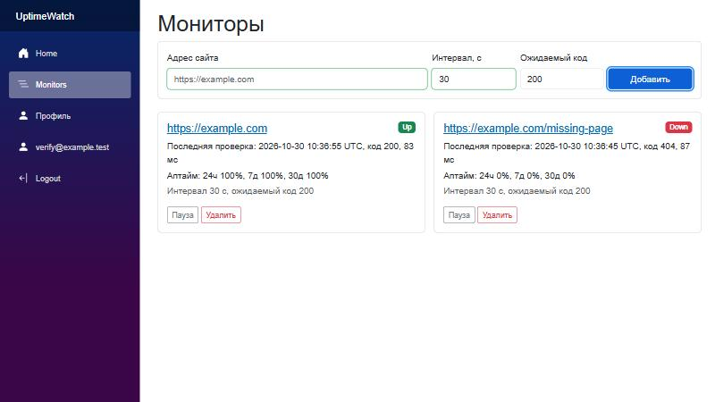
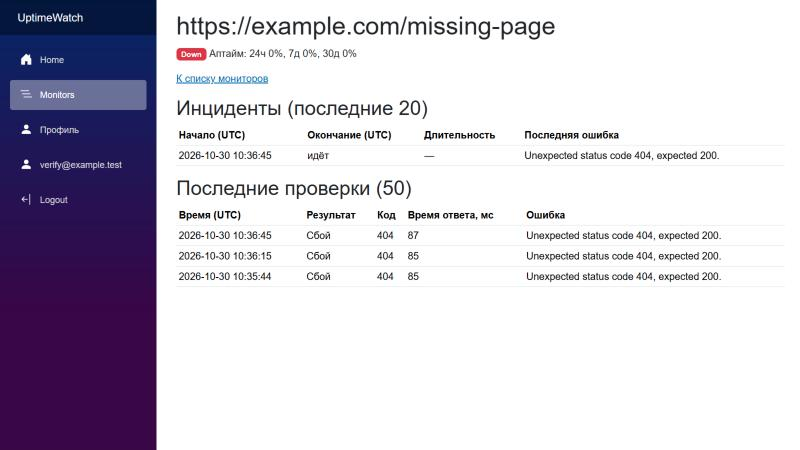
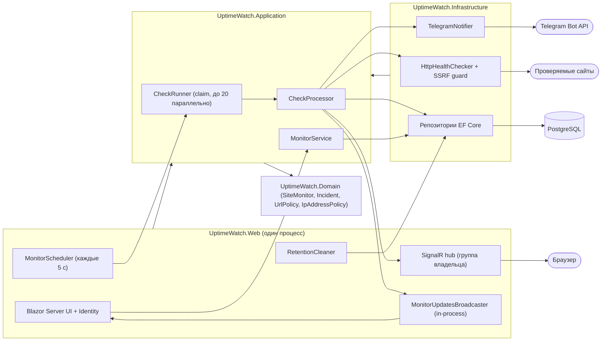

# UptimeWatch

[](https://github.com/Eksailed/UptimeWatch/actions/workflows/ci.yml)

Сервис мониторинга доступности сайтов на .NET 9: фоновые HTTP-проверки, история и аптайм, инциденты, живой дашборд и алерты в Telegram. Пользователь добавляет сайты, сервис по расписанию их проверяет и сообщает, когда сайт упал и когда восстановился.





## Возможности

- Мониторы: URL (http/https), интервал (от 30 секунд), ожидаемый код ответа; до 20 мониторов на пользователя.
- Фоновые проверки с таймаутом 10 с, ограничением размера ответа (256 КБ), редиректами (до 5) и ограничением параллелизма (20 проверок одновременно).
- История результатов, аптайм за 24 часа, 7 и 30 дней; результаты старше 30 дней удаляются автоматически.
- Инциденты: сайт считается упавшим после 3 неудачных проверок подряд; первая успешная проверка закрывает инцидент. Пока инцидент открыт, повторных алертов нет.
- Живой дашборд без перезагрузки страницы (Blazor Server и SignalR).
- Алерты в Telegram о падении и восстановлении (с длительностью простоя).
- Регистрация и вход (ASP.NET Core Identity); каждый пользователь видит только свои мониторы.
- Защита от SSRF: сервис ходит по адресам, которые вводит пользователь, поэтому loopback, приватные сети и link-local адреса запрещены.
- Состояние (расписание, открытые инциденты) хранится в PostgreSQL и переживает перезапуск.

## Стек

ASP.NET Core (.NET 9), Blazor Server, SignalR, EF Core + Npgsql, PostgreSQL 17, ASP.NET Core Identity, xUnit, Testcontainers, Docker Compose, GitHub Actions.

## Быстрый старт (Docker Compose)

Нужны Docker и Docker Compose.

```bash
cp .env.example .env
# откройте .env и задайте POSTGRES_PASSWORD (см. ограничения ниже)
docker compose up --build
```

Откройте <http://localhost:8080>, зарегистрируйтесь и добавьте первый монитор. Миграции базы применяются автоматически при старте приложения.

- `POSTGRES_PASSWORD` в `.env` обязателен: в `.env.example` он намеренно пуст, и пока вы не зададите свой пароль, `docker compose` откажется запускаться. Значения по умолчанию в репозитории нет. Приложение получает пароль через `PGPASSWORD`, а не в строке подключения, поэтому `;` и `=` допустимы. Но значение разбирает парсер `.env`/Compose, поэтому не используйте в нём `$`, кавычки, пробелы и `#`.
- Если задан `TELEGRAM_BOT_TOKEN` неверного формата (не вида `123456789:AA...`), приложение завершится при старте с ошибкой настройки; оставьте переменную пустой, если Telegram не нужен.
- `TELEGRAM_BOT_TOKEN` необязателен; без него алерты только пишутся в лог (см. [Настройка Telegram](#настройка-telegram)).
- PostgreSQL не публикуется на хост: к нему ходит только контейнер приложения.
- Данные БД лежат в томе `pgdata`, ключи ASP.NET Data Protection (чтобы сессии входа переживали перезапуск контейнера) в томе `dpkeys`. Остановить с сохранением данных: `docker compose down`; удалить вместе с данными: `docker compose down -v`.

### HTTPS и обратный прокси

Compose-конфигурация отдаёт приложение по обычному HTTP на порту 8080, без TLS. Для публичного доступа поставьте перед ним обратный прокси с HTTPS (Caddy, nginx, Traefik) и задайте контейнеру `web` переменную `ASPNETCORE_FORWARDEDHEADERS_ENABLED=true`, чтобы приложение доверяло заголовкам `X-Forwarded-Proto` и `X-Forwarded-For` от прокси и считало схему запроса https (иначе cookie входа не получит флаг Secure). Эта переменная заставляет приложение доверять этим заголовкам от любого отправителя, поэтому достучаться до порта 8080 должен только прокси: опубликуйте порт как `127.0.0.1:8080:8080` (прокси на том же хосте) или уберите публикацию порта и подключите прокси к сети Compose. Иначе любой клиент сможет подделать `X-Forwarded-*`.

Если приложение само слушает https (`ASPNETCORE_URLS` или `Kestrel:Endpoints:*:Url` с `https://`, либо задан `HTTPS_PORT`/`HTTPS_PORTS`), включаются редирект на HTTPS и HSTS. За прокси, который терминирует TLS, приложение HSTS не отправляет: заголовок `Strict-Transport-Security` должен выставлять сам прокси. Настройка прокси и сертификатов остаётся за оператором.

При `Scheduler:Enabled=false` фоновые проверки и очистка старых результатов выключены (приложение пишет об этом предупреждение в лог). По умолчанию оно включено.

## Локальная разработка без Docker

Нужен .NET 9 SDK и PostgreSQL. Проще всего поднять базу контейнером с параметрами, которые уже прописаны в `src/UptimeWatch.Web/appsettings.Development.json`:

```bash
docker run --name uptimewatch-db -d -p 127.0.0.1:5432:5432 \
  -e POSTGRES_USER=uptimewatch -e POSTGRES_PASSWORD=dev-only-change-me -e POSTGRES_DB=uptimewatch \
  postgres:17

dotnet run --project src/UptimeWatch.Web --launch-profile http   # http://localhost:5147
```

Свою строку подключения и токен бота храните в user-secrets, а не в репозитории:

```bash
dotnet user-secrets set "ConnectionStrings:Default" "Host=localhost;Port=5432;Database=uptimewatch;Username=uptimewatch;Password=<пароль>" --project src/UptimeWatch.Web
dotnet user-secrets set "Telegram:BotToken" "<токен>" --project src/UptimeWatch.Web
```

Если строка подключения нигде не задана, приложение при старте завершится с понятным сообщением.

## Настройка Telegram

Токен бота один на всё приложение, а у каждого пользователя свой `chat_id`.

1. В Telegram напишите [@BotFather](https://t.me/BotFather), создайте бота командой `/newbot` и скопируйте токен вида `123456789:AA...`.
2. Передайте токен приложению: `dotnet user-secrets set "Telegram:BotToken" "<токен>" --project src/UptimeWatch.Web` локально или `TELEGRAM_BOT_TOKEN=<токен>` в `.env` для Docker Compose (в контейнер он попадёт как `Telegram__BotToken`). Перезапустите приложение. Токен нельзя коммитить, `.env` занесён в `.gitignore`.
3. Узнайте свой `chat_id`: откройте диалог со своим ботом и отправьте ему `/start` (бот не может написать первым). Затем откройте в браузере `https://api.telegram.org/bot<токен>/getUpdates` и найдите в ответе `message.chat.id`. Для личного чата это ваш числовой id; для группы (если добавили туда бота) id отрицательный. Эта ссылка содержит токен, не отправляйте её другим. Свой id также показывает бот вроде [@userinfobot](https://t.me/userinfobot).
4. В приложении откройте страницу **Профиль**, введите `chat_id` (число или `@имя_канала`), сохраните и нажмите **Отправить тест**. Тестовое сообщение можно отправлять не чаще раза в 30 секунд.

Если токен не задан, страница профиля показывает предупреждение, а алерты только пишутся в лог. Недоступность Telegram не ломает цикл проверок: ошибка логируется, токен в сообщения об ошибках не попадает.

## Архитектура

Модульный монолит со слоями в духе Clean Architecture: `Domain` ни от кого не зависит, `Application` зависит только от `Domain`, а `Infrastructure` и `Web` реализуют интерфейсы `Application` (`Domain` ← `Application` ← `Infrastructure` / `Web`).



Поток проверки: `MonitorScheduler` раз в 5 секунд просит `CheckRunner` арендовать (claim) просроченные мониторы, `CheckProcessor` для каждого вызывает `IHealthChecker`, применяет результат к доменной модели (порог, открытие и закрытие инцидента), сохраняет его в PostgreSQL, публикует обновление дашборду и отправляет алерт, если инцидент открылся или закрылся. Границы `IHealthChecker`, `INotifier` и `IMonitorNotifications` позволяют вынести проверки в отдельный процесс или добавить другие каналы уведомлений без правок в бизнес-правилах.

## Решения и компромиссы

- **Монолит вместо двух процессов.** Веб и проверки живут в одном процессе ASP.NET Core: проще запускать, деплоить и отлаживать. Цена: проверки и UI делят ресурсы. Граница `IHealthChecker` оставляет возможность вынести проверки в отдельный Worker.
- **Порог в 3 проверки.** Монитор считается упавшим после 3 неудачных проверок подряд (`MonitorLimits.FailureThreshold`). Это защищает от ложных алертов из-за единичного сбоя сети; цена в том, что о падении мы узнаём на 2 интервала позже. Порог (3) зашит константой в `MonitorLimits` и не настраивается ни через конфигурацию, ни в интерфейсе.
- **SSRF-защита на уровне соединения.** URL вводит пользователь, поэтому разовой проверки адреса до запроса недостаточно (DNS rebinding, редиректы). Перед каждым соединением имя резолвится, полученные IP проверяются политикой (loopback, приватные, link-local и т. п. запрещены), и это повторяется на каждом шаге редиректа. Дополнительно ограничены схемы (только http/https), URL с логином и паролем отклоняются, а также таймаут, размер ответа и число редиректов.
- **Аренда монитора вместо блокировок.** Планировщик атомарно забирает просроченные мониторы запросом с `FOR UPDATE SKIP LOCKED` и сдвигает `NextCheckAt` на время аренды (60 с). Блокировки не держатся на время HTTP-запроса. Если процесс упал посреди проверки, аренда истекает и монитор проверяется заново; несколько экземпляров приложения не берут один монитор дважды.
- **Защищённая запись инцидентов (fencing).** Проверка работает с копией монитора, а за это время монитор могли удалить или обновить. Запись инцидентов проверяет, что состояние в БД не успело измениться; устаревшая копия отбрасывается, а не затирает более свежее состояние.
- **Обновления дашборда: in-process broadcaster плюс группа хаба.** Blazor-цепочки подписываются на обновления внутри процесса (`MonitorUpdatesBroadcaster`) и не нуждаются в SignalR-соединении «к самим себе». Для внешних клиентов то же событие уходит в SignalR-группу владельца; группа определяется сервером по пользователю, а не передаётся клиентом, поэтому чужие мониторы подписать нельзя. Сбой одного канала не мешает другому.
- **Состояние в БД.** Расписание и открытые инциденты хранятся в PostgreSQL, перезапуск ничего не теряет.

## Известные ограничения

- Нет подтверждения email, смены email и восстановления пароля: в проекте нет отправки почты (`RequireConfirmedAccount = false`), поэтому соответствующие страницы Identity удалены. Неудачные входы блокируют аккаунт на 5 минут после 5 попыток. Регистрация открыта для любого, кто видит сервис.
- Compose не включает HTTPS (см. раздел про обратный прокси); ключи Data Protection хранятся в томе в незашифрованном виде, том нужно считать секретом.
- Кулдаун тестовых сообщений Telegram хранится в памяти процесса: после перезапуска он сбрасывается, а при нескольких экземплярах не общий.
- Об упавшем сайте приходит один алерт; повторных напоминаний нет.
- Отправка в Telegram выполняется внутри слота параллелизма проверки (до 20 одновременно), а аренда монитора длится 60 с: медленный ответ Telegram занимает слот, а при очень долгой отправке аренда может истечь и монитор будет проверен повторно. Архитектура рассчитана на один экземпляр приложения.
- Удаление аккаунта (страница «Personal data») каскадно удаляет его мониторы, результаты проверок и инциденты.
- Порядок карточек на дашборде при живом добавлении считается по ordinal-сравнению URL, а загрузка списка сортируется на стороне БД по её collation, поэтому порядок может отличаться до перезагрузки страницы.
- Живые обновления идут внутри процесса: при нескольких экземплярах за балансировщиком дашборд получает обновления только от проверок своего экземпляра (нужен backplane).
- Проверки выполняются с сервера, где запущено приложение, и отражают доступность оттуда; точность интервалов около 5 секунд (период планировщика).

## Что дальше

- Публичная статус-страница.
- Графики времени ответа и аптайма.
- Проверка срока действия SSL-сертификата.
- Повторная отправка алертов (напоминания об открытом инциденте) и другие каналы уведомлений.
- Подтверждение email и сброс пароля.

## Тесты

Тесты написаны на xUnit и лежат в `tests/`:

- `UptimeWatch.Domain.Tests`: правила инцидентов, порог неудач, политики URL и IP.
- `UptimeWatch.Application.Tests`: сценарии с заглушками `IHealthChecker` и `INotifier`.
- `UptimeWatch.Integration.Tests`: репозитории, SSRF-защита, веб-приложение, SignalR, Telegram и полный цикл «проверка → инцидент → уведомление» против реального PostgreSQL.

Интеграционные тесты поднимают PostgreSQL через Testcontainers, поэтому для них нужен запущенный Docker.

```bash
dotnet test -c Release
```

GitHub Actions собирает проект, прогоняет тесты и проверяет сборку Docker-образа при каждом пуше.

## Структура проекта

```
UptimeWatch/
├─ src/
│  ├─ UptimeWatch.Domain          сущности и правила, без зависимостей
│  ├─ UptimeWatch.Application     сценарии использования и интерфейсы
│  ├─ UptimeWatch.Infrastructure  EF Core, HTTP-проверки, Telegram
│  └─ UptimeWatch.Web             Blazor Server, SignalR, Identity, фоновые сервисы
├─ tests/                         Domain / Application / Integration
├─ docs/                          дизайн-спецификация и скриншоты
├─ Dockerfile
├─ docker-compose.yml
└─ .env.example
```

Подробности и обоснования: [дизайн проекта](docs/superpowers/specs/2026-10-30-uptimewatch-design.md).
